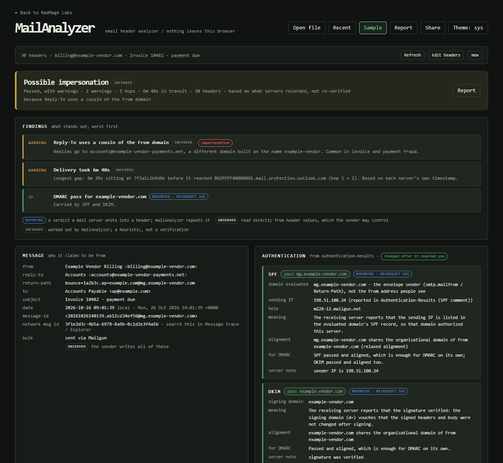

# MailAnalyzer

A local-first email header analyzer for SPF, DKIM, DMARC, Microsoft 365, mail routing, phishing indicators and troubleshooting. Paste a message's headers, or open an `.eml` or Outlook `.msg`, and it explains what the mail servers recorded: who it says it is from, whether authentication passed and who vouched for it, how Microsoft 365 filtered it, where it was delayed, and what looks wrong. Everything runs in your browser. Nothing is uploaded.

**Use it at [radmagelabs.com/mailanalyzer](https://radmagelabs.com/mailanalyzer/)**, or download the release and open it from your own computer.

Current version: **v1.0.1**



## Features

- **Authentication:** SPF, DKIM and DMARC results with what each one means, relaxed alignment against the From domain, which mechanism carried DMARC, ARC, and Microsoft's composite authentication (`compauth`) with its reason codes.
- **A trust boundary:** MailAnalyzer works out where the message entered your systems and labels every verdict by where it came from: **reported** by a mail server, **observed** in sender-controlled headers, **inferred** by MailAnalyzer, or **untrusted** because it sits where the sender could have written it.
- **Microsoft 365 and Exchange Online Protection:** SFV, SCL, CAT, BCL, PCL, SFTY, SRV, IPV, CIP and the rest of `X-Forefront-Antispam-Report` and `X-Microsoft-Antispam`, the `X-MS-Exchange-Organization-*` stamps, the Network-Message-Id for Message trace and Threat Explorer, and the folder in `X-Microsoft-Antispam-Mailbox-Delivery`.
- **Routing:** the Received chain oldest first, the delay at each hop, total transit time, where the message sat longest, clock skew, TLS notes, and the gap between the Date header and the first hop.
- **Other filters:** Mailgun, Proofpoint, Mimecast, SpamAssassin, rspamd and virus scanner stamps.
- **Phishing and impersonation indicators:** a category headline (malware, phishing, impersonation, spam, bulk or automated), lookalike, punycode and mixed-alphabet domains, brand names in the sender name, free webmail used for business roles or replies, Reply-To tricks, display names that show a different address, repeated From headers, hidden and text-direction characters, and DKIM signatures that cover less than they appear to.
- **Your domains:** list your mail domains in About and MailAnalyzer recognizes your own servers and lookalikes of your domains.
- **A troubleshooting report** to paste into a ticket, with masking options, plus copy and download of the original headers.
- **Recent history** in this browser, light and dark themes, keyboard shortcuts, and a layout that works from 320 pixels wide.
- **Share** sends the page's public address, `https://radmagelabs.com/mailanalyzer/`, through your device's share sheet, or copies it where there is no share sheet. **Back to RadMage Labs**, above the title, goes to the rest of my tools.

## Supported input

- Raw headers pasted from any mail client. Pasting analyzes straight away.
- `.eml` files. Only the header block is read (the first 2 MB of the file, up to the first blank line); the body is never kept.
- Outlook `.msg` files. Only the stored internet headers (`PR_TRANSPORT_MESSAGE_HEADERS`) are read; the body and attachments are not.
- Plain text files holding a header block.

Open a file with **Open file**, the `o` key, or by dropping it on the page.

## Using it

1. Copy the headers. Outlook desktop: open the message, then File, Properties, Internet headers. Outlook on the web: the three dots, View, View message source. Gmail: the three dots, Show original.
2. Paste them, or open the saved message.
3. Read the headline, then the findings, worst first. Each one carries its basis (reported, observed, inferred or untrusted) and, where it supports one, a category.
4. Press **Report** (or `r`) for a text summary to share.

Keyboard: `ctrl`+`enter` analyze, `r` report, `R` (shift+r) refresh, `e` edit the headers, `/` filter the original headers, `o` open a file, `h` recent, `esc` clear the filter.

## Microsoft 365 troubleshooting examples

- **"Why did this go to Junk?"** Look at the Microsoft 365 section. `SFV:SPM` with `SCL` 5 or 6 means the spam filter junked it; `CAT` names the reason (`SPM`, `HSPM`, `PHSH`, `SPOOF`, `BULK`). `X-Microsoft-Antispam-Mailbox-Delivery` with `dest:J` is the Junk Email folder. A `compauth=fail` with reason `001` means the sender's domain has no enforcing DMARC policy and Microsoft's own evaluation failed it.
- **"A partner's mail fails DMARC."** The authentication cards show which domain SPF checked (the envelope sender, not the From address) and which domain signed with DKIM. If neither matches the From domain's organization, DMARC fails even when SPF and DKIM pass. Forwarding breaks SPF; a gateway that rewrites the message breaks DKIM.
- **"It arrived an hour late."** The route section shows each hop's own timestamp and names the server where the message sat longest. The times are each server's claim, so a large negative gap is a clock problem, not a delay.
- **"It got through when it shouldn't have."** `SFV:SKA`, `SKN` or `SFE`, or `SCL:-1`, means filtering was skipped by an allow list, a mail flow rule or the user's Safe Senders. Check those before tuning the spam policy.
- **"Find it in Message trace."** Copy the Network-Message-Id from the message summary; Message trace and Threat Explorer search on it.

## Security and privacy

- **Nothing leaves your browser.** The page makes no network requests after it loads: no DNS lookups, no APIs, no analytics, no tracking, no fonts or scripts from anywhere else. Its Content Security Policy blocks inline scripts and all outgoing connections (`connect-src 'none'`).
- **What it keeps, all in this browser:** the theme, the report options, your domains, and a recent list of up to 25 header blocks in `localStorage`; the message you are looking at in `sessionStorage`, gone when the tab closes. Only headers are ever stored, never a body pasted with them, and never attachments. Remove items or clear the list from the Recent dialog; **New** forgets the current message.
- **Share passes the public address only.** It is the same address wherever the page was opened (radmagelabs.com, GitHub Pages or a file on disk), with no query string or tracking parameters, and nothing you analyzed goes with it. The page never puts headers, addresses or message IDs in its own address.
- **Masking is partial.** The report's masking option hides the mailbox part of addresses (`j***@example.com`) and nothing else. Display names, domains, host names, IP addresses, the subject (unless you hide it) and encoded values such as tracking IDs stay as they are, and Message-ID and Network-Message-Id are never masked. Headers can identify people and systems; read a report before you share it.
- **Untrusted text is treated as text.** Every header value is escaped before it is shown, and invisible and text-direction characters are spelled out as `[U+XXXX]` on screen and in reports, so a header cannot run code in the page or reorder what you read.
- **Hostile files are bounded.** A header block is read up to 1 MB and 5000 headers, each header up to 64 KB; `.msg` files up to 100 MB, with every size and sector number checked against the file before use.

To report a security problem, open a [GitHub issue](https://github.com/RadMageIRL/mailanalyzer/issues) without the details and ask for a private channel, or use GitHub's private vulnerability reporting on this repository. Please do not include real message headers.

## What header analysis cannot tell you

- **Every verdict is a claim.** MailAnalyzer does not query DNS, verify DKIM signatures, check SPF records or look up IP reputation. It reports what the receiving servers wrote, and labels where each verdict came from.
- **The trust boundary is inferred** from host names in the Received chain: the newest hop received by Exchange Online's front door (`*.mail.protection.outlook.com`) or a host on your domains, and only when every newer hop is Microsoft 365 or yours. Without one (for example, mail read in Gmail or Yahoo), every verdict is shown as unconfirmed. Mail forwarded out of your systems, a partial paste, or an unusual relay setup can hide the boundary too.
- **Alignment uses a built-in approximation** of the Public Suffix List and assumes relaxed alignment, since the domain's actual DMARC policy is in DNS.
- **The phishing indicators are heuristics.** The brand list is short and hand-picked, and free webmail checks will sometimes flag an honest small business; those findings say "possible", never "likely".
- **Received timestamps are each server's own clock.** A date with no time zone is read as UTC, as RFC 5322 says.
- `X-Microsoft-Antispam-Mailbox-Delivery` is not documented by Microsoft; only the Inbox and Junk folder codes are decoded.

## Browser support

The release was tested with the browser suite in this repository on Windows in Google Chrome 157 (Chromium), Firefox 157 and WebKit 27.2 (Playwright's builds of the Safari engine), at widths from 320 to 1440 pixels and with touch emulation in Chromium and WebKit, both served from a web server and opened from disk. CI runs the same suite on Linux in Playwright's Chromium, Firefox and WebKit. Real Safari on macOS or iOS was not tested.

## Run it locally

Download `MailAnalyzer-v1.0.1.zip` from the [latest release](https://github.com/RadMageIRL/mailanalyzer/releases/latest), unzip it and open `MailAnalyzer-v1.0.1/index.html` in a current browser. It works offline from disk. Check the download against `SHA256SUMS.txt` from the same release.

## Development

There is nothing to build for the page itself: `index.html`, `mailanalyzer-core.js` (the analysis, shared with the tests) and `app.js` (the page) are served as they are.

```sh
npm ci                        # only the test tooling (Playwright)
node --test "tests/*.test.js" # unit tests and release checks
node tools/build.mjs --verify # the site files and the release zip, built three times to prove they are identical
npx playwright install chromium firefox webkit
npm run test:e2e              # browser tests, served under /mailanalyzer/
```

Test fixtures use only example domains and documentation IP addresses. Please keep it that way in issues and pull requests too: never paste real headers.

## License

MIT License. Copyright (c) 2026 RadMageIRL. See [LICENSE](LICENSE).

The styling and interaction patterns come from Kard, an earlier project of mine.
